# TUGAS PPW - WEEK 9

**Disusun Oleh:**  
Geusan Edurais Aria Daffa / 103122400026  
SE - 08 - 01  

**Dosen Pengampu:**  
Arif Amrulloh, S.Kom., M.Kom.  

**PROGRAM STUDI S1 SOFTWARE ENGINEERING**  
**FAKULTAS INFORMATIKA**  
**TELKOM UNIVERSITY PURWOKERTO**  
**2026**

---

## Tahapan Pembuatan Backend RecipeMate Menggunakan NestJS (MVC)

### 1. Inisialisasi Proyek NestJS dan Konfigurasi Git
Proyek backend diinisialisasi menggunakan Nest CLI dengan package manager `npm`, kemudian dihubungkan ke remote repository GitHub:
- Branch `main`: Branch rilis produksi.
- Branch `develop`: Branch integrasi pengembangan.
- Branch fitur: `feature/recipes-mvc-crud` dan `feature/nest-backend-integration`.

```bash
nest new recipe_mate_backend --package-manager npm
git init -b main
git remote add origin https://github.com/Geusan31/recipe_mate_backend.git
git checkout -b develop
git checkout -b feature/recipes-mvc-crud
```

---

### 2. Installasi Package yang Diperlukan (class-validator & class-transformer)
Instalasi pustaka validasi DTO untuk menjalankan validasi skema payload data resep:
```bash
npm install class-validator class-transformer @nestjs/mapped-types
```

---

### 3. Pembuatan Resource dan Entity Recipe
Resource `recipes` dibuat dengan perintah Nest CLI (`nest g resource recipes`). Entity `Recipe` dikonfigurasi pada `src/recipes/entities/recipe.entity.ts` dengan struktur data yang dibutuhkan frontend RecipeMate (memiliki lebih dari 5 field dengan variasi tipe data: `string`, `number`, `Date`, `Array`, dan `object`):

- `id`: string (Identifikasi unik resep)
- `slug`: string (Slug ramah URL)
- `title`: string (Nama resep)
- `description`: string (Deskripsi hidangan)
- `category`: string (Kategori sajian)
- `time`: number (Waktu memasak dalam menit)
- `servings`: number (Porsi)
- `difficulty`: 'Mudah' | 'Sedang' | 'Sulit' (Enum kesulitan)
- `rating`: number (Skor ulasan)
- `ingredients`: Array<{ group: string, items: string[] }> (Daftar bahan)
- `steps`: string[] (Tahapan memasak)
- `createdAt` & `updatedAt`: Date (Timestamp)

**Tangkapan Layar Struktur Folder:**  
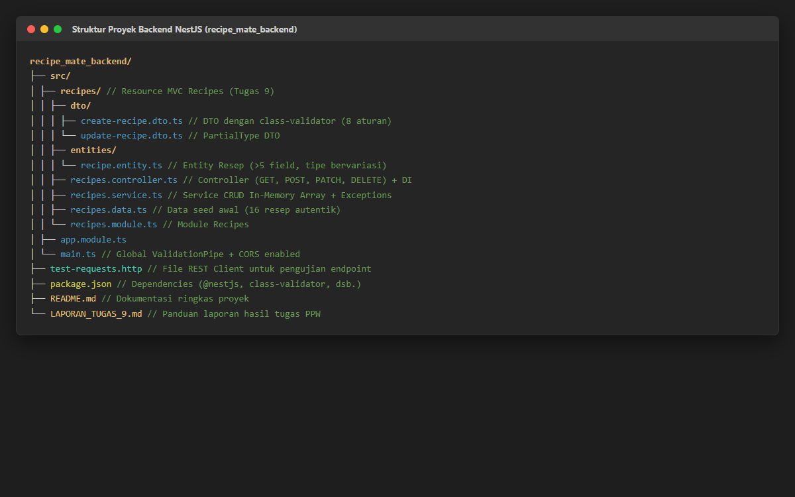

---

### 4. Pembuatan DTO dan Aturan Validasi (class-validator)
File `create-recipe.dto.ts` dibuat dengan 8 aturan validasi berbeda untuk memastikan data yang dikirimkan klien valid dan aman:
- `@IsString()` dan `@IsNotEmpty()` untuk nama, deskripsi, dan kategori.
- `@MinLength(3)` untuk memastikan panjang judul resep minimal 3 karakter.
- `@IsNumber()` dan `@Min(1)` untuk waktu memasak dan porsi minimal 1.
- `@IsIn(['Mudah', 'Sedang', 'Sulit'])` untuk memastikan nilai tingkat kesulitan sesuai ketentuan.
- `@IsArray()` untuk memastikan format bahan dan langkah berupa array.

File `update-recipe.dto.ts` meng-inherit `CreateRecipeDto` menggunakan `PartialType` bawaan `@nestjs/mapped-types`.

---

### 5. Implementasi Service dengan In-Memory CRUD & Error Handling
Pada file `recipes.service.ts`, data disimpan sementara di dalam memory array (`private recipes: Recipe[] = [...]`) dan diisi 16 resep autentik awal. Service mengimplementasikan:
1. `create()`: Menambahkan resep baru, menghasilkan ID dan slug otomatis, serta menangani error `ConflictException` (409) jika terdapat duplikasi judul/slug.
2. `findAll()`: Mengambil daftar seluruh resep dengan dukungan filter pencarian dan kategori.
3. `findOne()`: Mengambil detail resep berdasarkan ID atau slug, menangani error `NotFoundException` (404) jika data tidak ditemukan.
4. `update()`: Memperbarui data resep parsial dan menangani error `NotFoundException` (404) serta `ConflictException` (409).
5. `remove()`: Menghapus data resep dari in-memory array dan menangani error `NotFoundException` (404).

---

### 6. Implementasi Controller dengan Dependency Injection
File `recipes.controller.ts` memetakan seluruh HTTP Method ke method pada `RecipesService` melalui constructor injection:
- `POST /recipes`: Memanggil `recipesService.create()`
- `GET /recipes`: Memanggil `recipesService.findAll()`
- `GET /recipes/:id`: Memanggil `recipesService.findOne()`
- `PATCH /recipes/:id`: Memanggil `recipesService.update()`
- `DELETE /recipes/:id`: Memanggil `recipesService.remove()`

---

### 7. Konfigurasi Global ValidationPipe dan CORS di Main
Pada `src/main.ts`, global pipe diaktifkan agar validasi DTO berjalan otomatis pada setiap request, serta CORS diaktifkan agar frontend React dapat mengakses API backend:
```typescript
app.enableCors({ origin: '*' });
app.useGlobalPipes(
  new ValidationPipe({
    whitelist: true,
    forbidNonWhitelisted: true,
    transform: true,
  }),
);
```

---

### 8. Pengujian Endpoint Menggunakan REST Client
Seluruh endpoint diuji menggunakan REST Client (`test-requests.http`) dengan hasil pengujian sebagai berikut:

#### a. Pengujian GET /recipes (200 OK)
Mendapatkan seluruh koleksi resep yang tersimpan di memori backend.  
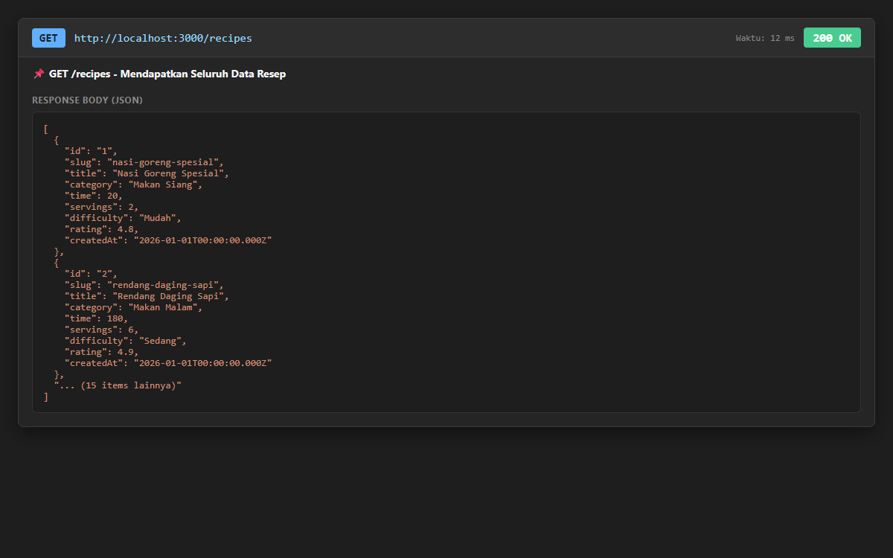

#### b. Pengujian GET /recipes/:id (200 OK)
Mengambil detail satu resep berdasarkan ID yang dicari.  
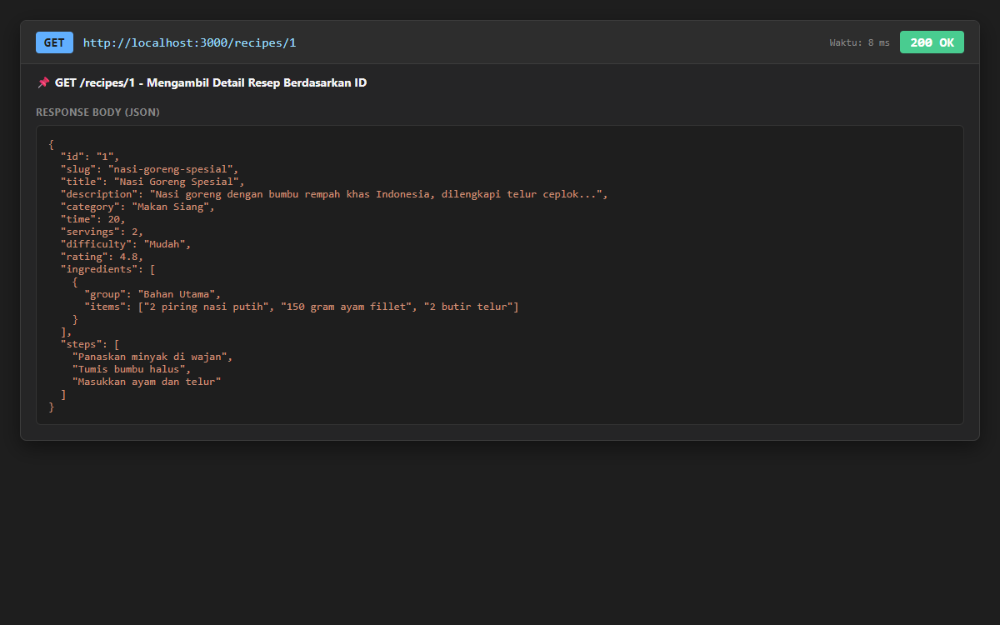

#### c. Pengujian POST /recipes (201 Created)
Menambahkan data resep baru ke dalam backend dengan payload lengkap.  
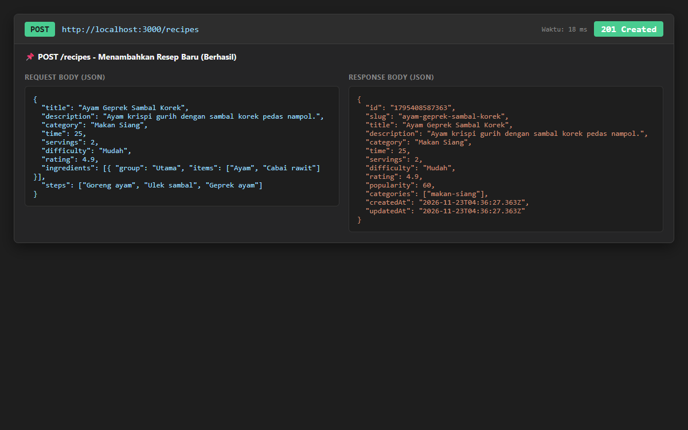

#### d. Pengujian Validasi Error class-validator (400 Bad Request)
Menguji pengiriman payload yang melanggar aturan DTO (misal: judul < 3 huruf, porsi negatif).  
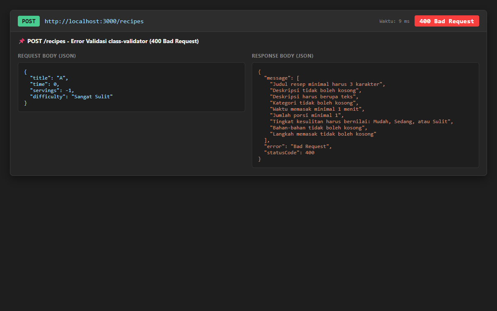

#### e. Pengujian ConflictException (409 Conflict)
Menguji penambahan resep dengan judul yang sudah ada di memori.  
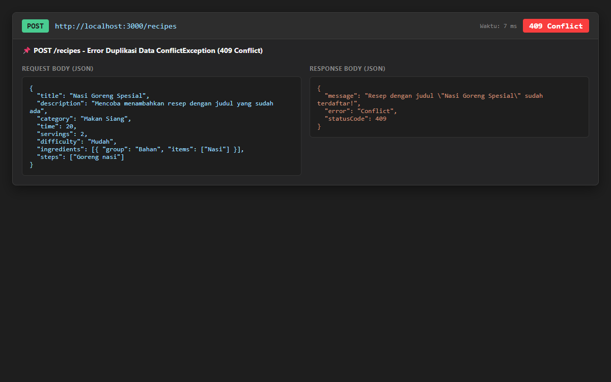

#### f. Pengujian NotFoundException (404 Not Found)
Menguji pengambilan atau modifikasi data resep dengan ID yang tidak terdaftar.  
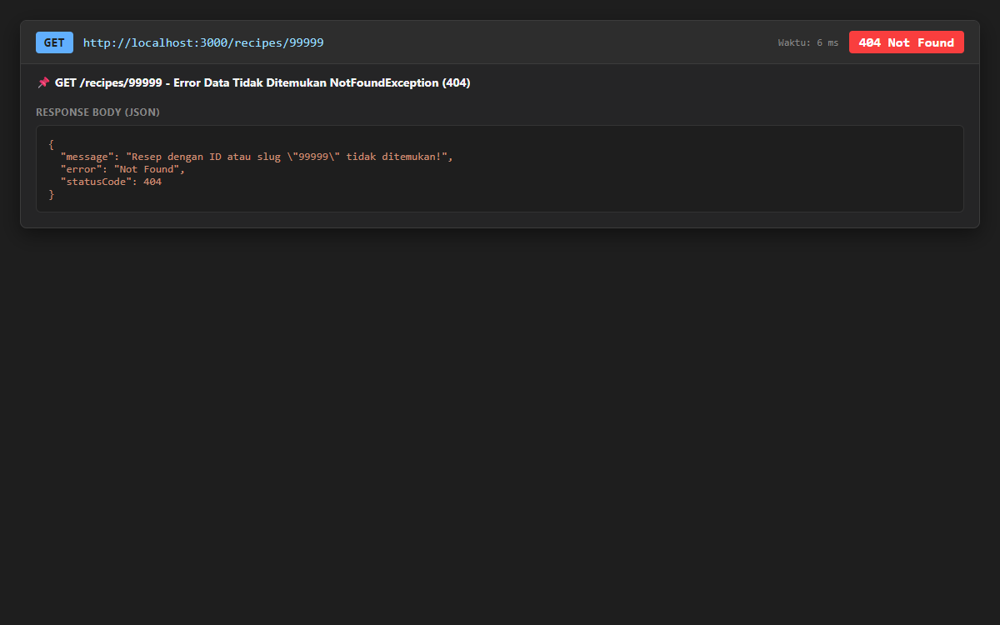

#### g. Pengujian PATCH /recipes/:id (200 OK)
Memperbarui sebagian atribut resep (misal: waktu dan rating).  
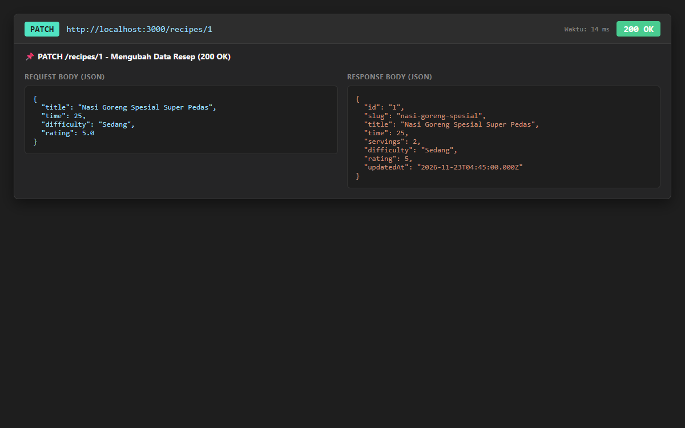

#### h. Pengujian DELETE /recipes/:id (200 OK)
Menghapus resep dari backend.  
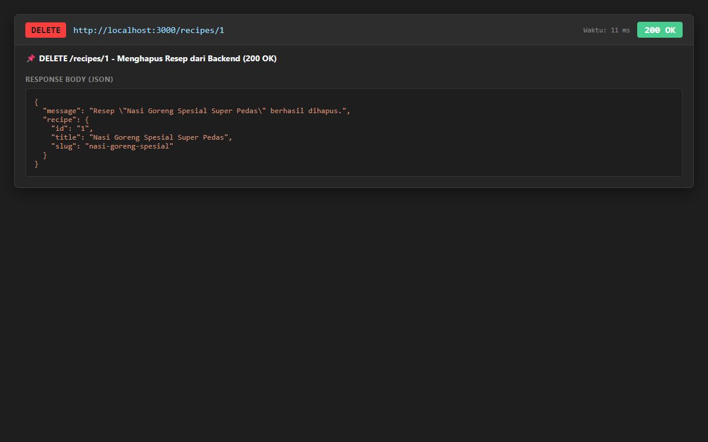

---

### 9. Integrasi Frontend React RecipeMate ke Backend NestJS
Frontend `recipe_mate` dihubungkan ke backend NestJS melalui service API `src/services/recipeApi.js` dan `AppContext.jsx`:
- Menu baru **"Kelola Resep"** ditambahkan pada navigasi navbar.
- Halaman **Kelola Resep** menampilkan status koneksi live NestJS, formulir tambah resep (POST), serta daftar resep dengan aksi Edit (PATCH) dan Hapus (DELETE).
- Halaman **Katalog Resep** dan **Detail Resep** kini langsung tersinkronisasi secara real-time dengan data dari backend.

#### Tampilan Beranda Frontend
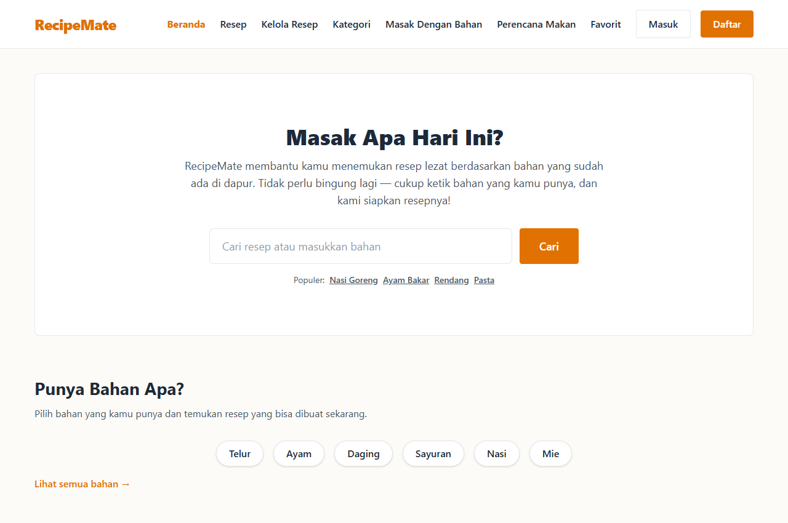

#### Tampilan Daftar Semua Resep dari Backend
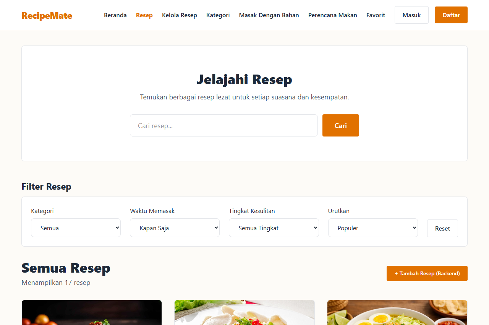

#### Tampilan Halaman Kelola Resep (CRUD Backend Active)
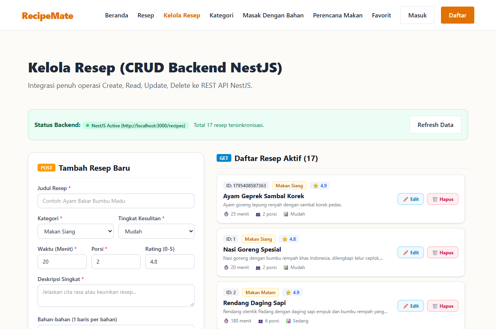

#### Pengisian Form Tambah Resep Baru (POST) di Frontend
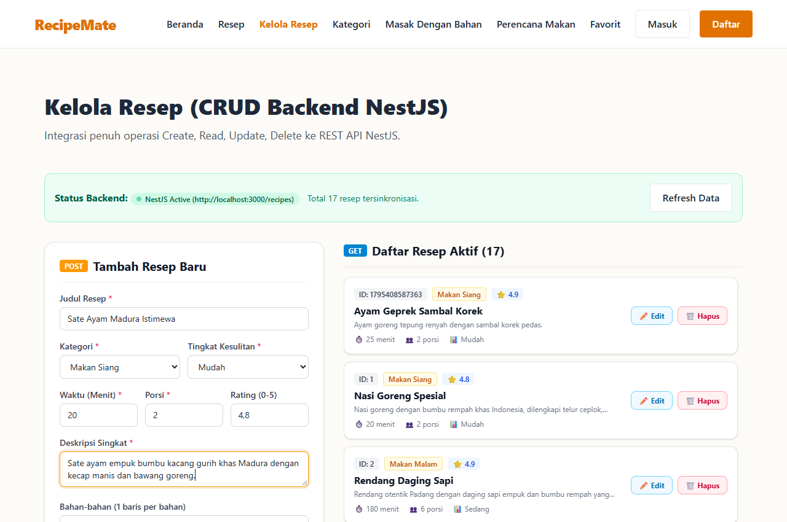

#### Hasil Data Resep Baru Muncul Real-time di Frontend
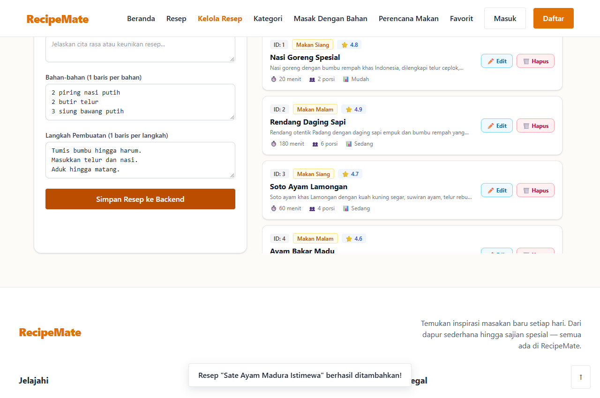

#### Tampilan Detail Resep dengan Aksi Kelola dan Hapus
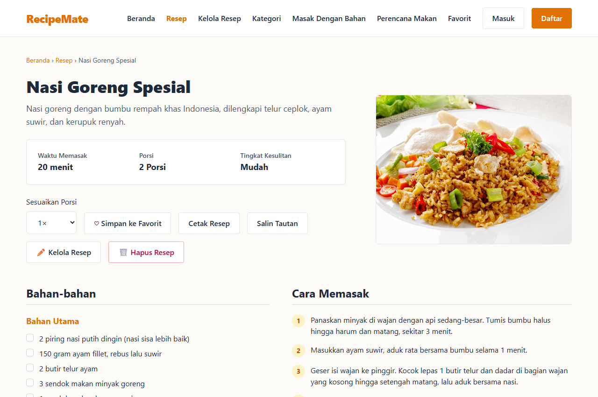

---

### 10. Tautan Repository GitHub
- **Repository Backend NestJS:** [https://github.com/Geusan31/recipe_mate_backend](https://github.com/Geusan31/recipe_mate_backend)  
- **Repository Frontend React:** [https://github.com/Geusan31/recipe_mate](https://github.com/Geusan31/recipe_mate)
